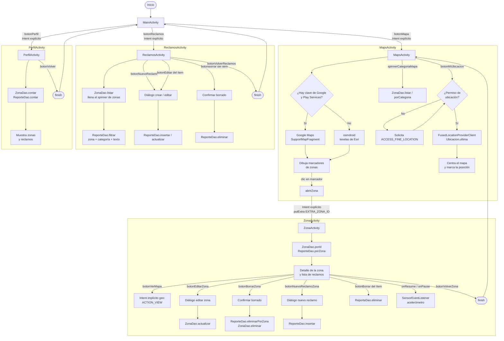

# Diagrama de flujo de actividades (UI Flow / Intents)

Navegación entre pantallas de la app, con los intents que se usan en cada salto.
Los intents son explícitos (`Intent(this, Destino::class.java)`) salvo el mapa
externo, que es un intent implícito `geo:`.

## Intents usados

| Origen | Destino | Tipo | Datos |
|---|---|---|---|
| `MainActivity` | `MapsActivity` | explícito | — |
| `MainActivity` | `ReclamosActivity` | explícito | — |
| `MainActivity` | `PerfilActivity` | explícito | — |
| `MapsActivity` | `ZonaActivity` | explícito | `putExtra(EXTRA_ZONA_ID, zona.id)` |
| `ZonaActivity` | app de mapas del sistema | implícito | `geo:lat,lon?q=...` con `ACTION_VIEW` |
