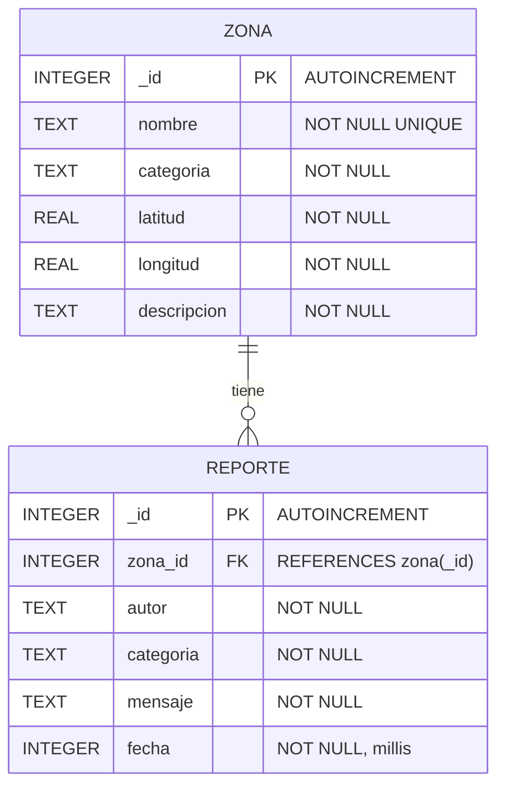

# Modelo entidad-relación de SQLite (ERD)

Esquema definido en `ContratoIquique` y creado por `BaseDeDatosHelper`. La base
se llama `iquique.db`, versión 2.



## Relación

- Una **zona** puede tener **muchos reportes** (1 : N).
- `reporte.zona_id` es clave foránea hacia `zona._id`.
- La relación se declara con `FOREIGN KEY (zona_id) REFERENCES zona(_id)`.
- Como SQLite no aplica el borrado en cascada por defecto, al eliminar una zona
  la app borra primero sus reportes con `ReporteDao.eliminarPorZona()`.

## Índice

```sql
CREATE INDEX idx_reporte_zona ON reporte(zona_id);
```

Acelera las consultas de reportes por zona (`ReporteDao.porZona`) y el `INNER JOIN`
que usa `ReporteDao.consultar()` para traer el nombre de la zona.

## Tipos

| Columna | Tipo SQLite | Uso |
|---|---|---|
| `_id` | `INTEGER` | clave primaria autoincremental (`BaseColumns._ID`) |
| `nombre`, `categoria`, `autor`, `mensaje`, `descripcion` | `TEXT` | texto |
| `latitud`, `longitud` | `REAL` | coordenadas geográficas |
| `fecha` | `INTEGER` | `Date.getTime()` en milisegundos |

## Migración

`BaseDeDatosHelper.onUpgrade()` borra ambas tablas y vuelve a llamar a `onCreate()`,
que recrea el esquema y carga el catálogo inicial de `IquiqueCatalogo.ZONAS`.
